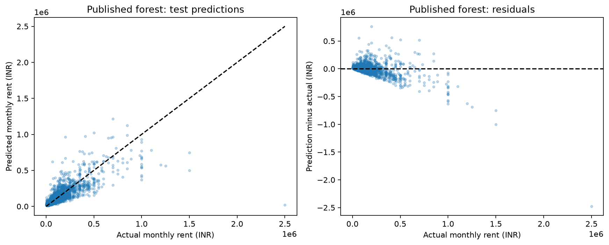
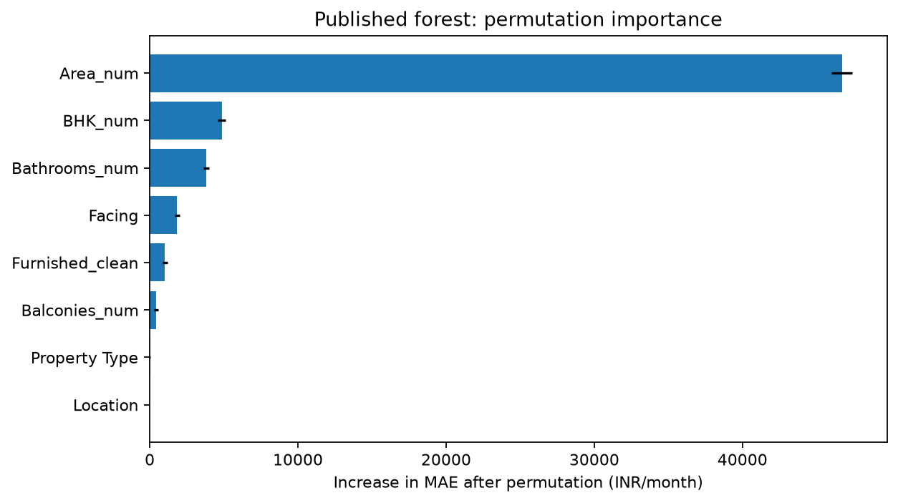

# Mumbai monthly rental prediction — Day 2

The submitted model is a **Random Forest regression pipeline** that predicts monthly Mumbai rent in INR from eight property attributes.

**Team:** Ahmed Belahcen, Nandini Rathod, Sanjana Kiran, Akanksha Dhumal.
**Course:** AI Methods I, IAAC MaAI 2026/27.
**Published model:** [Hugging Face](https://huggingface.co/iaac-maai/group3-day2-mumbairental).
**Documentation:** [Model card](models/README.md) · [Notebook](notebook/supervised_learning.ipynb) · [Detailed evaluation](models/evaluation.json).

## Use case

Housing researchers, architects and urban-design students can use this educational prototype to explore how property attributes relate to rental affordability in Mumbai. It estimates a listing's monthly rent from area, bedrooms, bathrooms, balconies, furnishing, facing, location and property type.

Underestimating rent can lead a household to plan an unaffordable budget. Overestimating it can cause suitable housing to be excluded. **MAE in INR/month is the main metric**, because it communicates the typical absolute error; RMSE gives greater weight to large errors. The remaining errors are too large for autonomous pricing, tenant screening, lending or investment decisions.

## Data

The cleaned snapshot contains **18,846 listings and 26 columns** from Harshal H's [Kaggle Property Rental Listings Dataset](https://www.kaggle.com/datasets/harshalhonde/property-rental-listings-dataset). One row represents a listing, not a verified unique dwelling. The source declares area in square feet. The dataset is separately licensed **CC BY 4.0**; the team's cleaned snapshot is a modification.

`data/mumbai_cleaned.csv` is the frozen Day 2 training snapshot, retained to reproduce the published model. Its SHA-256 is `354d28e07432137cdc97a2197a556269137e74135af01186420e2e2917a19ee9` (LF line endings). It is not replaced by subsequent Day 1 cleaning changes. [Day 1 repository](https://github.com/iaac-maai/Group3-day1assignment).

## Repository structure

| Path | Purpose |
|---|---|
| `notebook/supervised_learning.ipynb` | Experiments, final regression pipeline, evaluation and figure exports |
| `data/mumbai_cleaned.csv` | Frozen cleaned training snapshot |
| `figures/` | Exported notebook plots, including the submitted forest |
| `models/README.md` | Model card |
| `models/evaluation.json` | Published evaluation and provenance |
| `models/predict_example.py` | Download and test the reviewed Hub model |
| `models/reproduce_evaluation.py` | Evaluate the trusted published artifact |
| `requirements.txt` | Pinned runtime packages |
| `LICENSE` | MIT code licence |

Trained `.joblib` files are ignored by Git and published on Hugging Face. Running the notebook regenerates local files under `models/`, outside the notebook folder.

## How to run

Use Python 3.12 and run from the repository root:

```bash
python -m venv .venv
# Windows: .venv\Scripts\activate
# macOS/Linux: source .venv/bin/activate
python -m pip install -r requirements.txt
python -m pip install jupyterlab nbclient==0.10.2 nbformat==5.10.4 ipykernel==6.29.5
jupyter lab
```

Open `notebook/supervised_learning.ipynb`, restart the kernel, and run all cells in order. The notebook uses the local cleaned CSV, exports figures to `figures/`, and saves/reloads its local trained pipeline. No upload to Hugging Face occurs during execution. The CI workflow repeats execution in a fresh environment and preserves the executed notebook and figures as an artifact.

The reviewed Hugging Face revision referenced by the model card can be tested with:

```bash
python models/predict_example.py --revision refs/pr/4
```

This example verifies the reviewed model's checksum. A newly trained serialization may have different bytes even when predictions match. Only load trusted joblib files.

## Approach and results

The regression uses an 80/20 shuffled split with seed 42: **15,076 training and 3,770 test rows**. Preprocessing stays inside the pipeline: numeric median imputation without scaling; categorical mode imputation followed by one-hot encoding. The selected forest has 200 trees, maximum depth 10, minimum leaf size 5 and seed 42. The notebook compares baselines, linear regression, decision trees, Random Forest and gradient boosting, and retains its tuning experiment.

| Submitted forest metric | Test | Five-fold training CV mean ± standard deviation |
|---|---:|---:|
| R² | 0.6187 | 0.6516 ± 0.0704 |
| MAE (INR/month) | 38,044.93 | 37,250.78 ± 711.52 |
| RMSE (INR/month) | 82,899.45 | 77,140.43 ± 10,150.57 |

CV uses five shuffled KFold splits with seed 42 and population standard deviation (`ddof=0`). These are the published evaluation values; the notebook checks the reproduced test metrics against them. The median baseline has test MAE 67,123.75 INR/month, so the forest reduces MAE by about **43%**, while substantial errors remain.



The diagonal represents perfect predictions; the residual panel makes underestimation and overestimation visible. The large gap between MAE and RMSE indicates that some listings have much larger errors than average.



Permutation importance measures the increase in test MAE after shuffling each input, with bars showing variation across five repeats. It describes predictive dependence, not a causal effect on rent. A near-zero result does not prove a feature is irrelevant in the real housing market.

## Limitations

The same CV folds informed tuning, so CV is non-nested and may be optimistic. Earlier teaching experiments repeatedly inspected the test set; it is not an untouched final validation sample. There are 2,487 repeated predictor/target rows, including 752 test rows matching training rows. A grouped split and a fresh external test set are needed before deployment.

`Location` is constant (`Mumbai`), so the model cannot distinguish neighborhoods. Listing prices are not verified transaction rents. Historical data, missing attributes, extreme prices and possible mixed area units limit generalization. The model should not be extrapolated to other cities or current market prices without new validation.

## AI usage disclosure

- **Tools:** ChatGPT/Codex assisted the repository cleanup documented here. The earlier model card records the model's provenance; this disclosure does not claim a complete log of every team member's earlier tool usage.
- **Why:** Make the submitted model unambiguous and improve reproducibility and documentation.
- **Where:** README, notebook paths and export cells, Git ignore rules, and automated execution checks.
- **How:** AI proposed edits from the existing code and evaluation records, and helped run checks. Model metrics are computed from data; they are not generated prose estimates.
- **Lessons learned:** A notebook can contain several experiments while the submission must identify one model. Saved outputs, correctly pinned packages and explicit limitations are essential; AI-written explanations must be checked against executed results.

## Licence

Code and model: **MIT**, see [LICENSE](LICENSE). Training data: **CC BY 4.0**, attributed separately above; the code licence does not relicense the dataset.

## Appendix: exploratory furnishing classification

The notebook also retains a separate furnishing-classification exercise. Its depth-5 Decision Tree accuracy is approximately 44.4%, versus a 43.8% majority baseline. It is not the submitted model. The older ROC-AUC near 0.577 belongs to the earlier unrestricted classifier and must not be attributed to the depth-5 classifier or the rent regressor.
